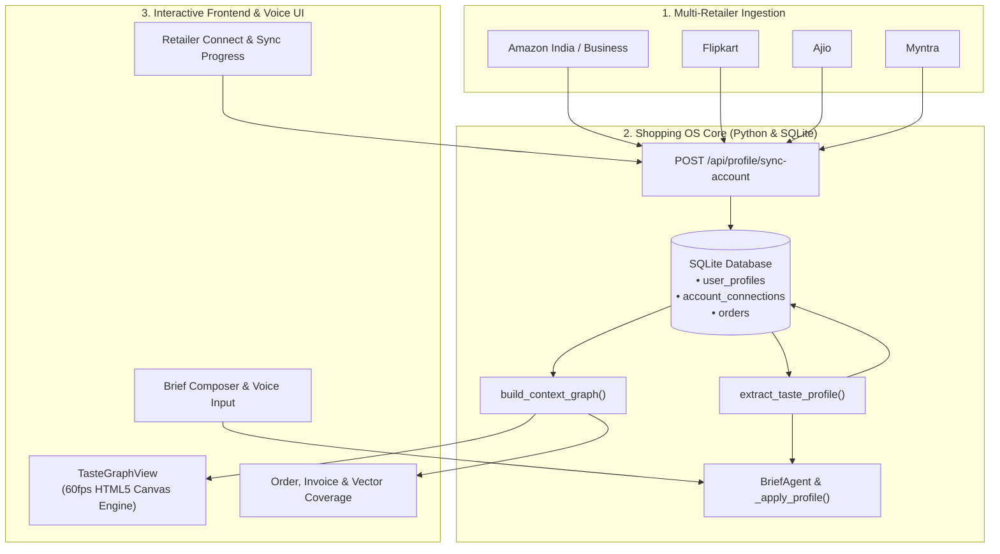

# Shopping OS: Engineering & Product Handoff Document

> **Version:** 1.0.0  
> **Date:** October 17, 2026  
> **Status:** Real local connection flow and semantic retrieval verified; authenticated retailer history and invoice coverage require account login  
> **Scope:** Retailer browser connections, six-month order history, invoice PDFs, saved inspiration memory, semantic retrieval, and search integration  

Verification: Amazon Business's asynchronous year selector and empty 2026 history were checked in the real authenticated browser. A real public link passed Gemini vision analysis, 768-dimensional embedding storage, and semantic retrieval in an isolated test database. Actual invoice downloads and private Instagram posts still require accounts with that content.

---

## Current behavior

Taste OS opens a dedicated local Chrome session for Amazon, Flipkart, Myntra, Ajio, or Instagram. Users enter credentials and OTPs directly in that retailer window. Retailer jobs collect dated order evidence for the last six calendar months, follow pagination, and save available invoice PDFs. Unknown layouts, missing dates, expired sessions, and missing invoices produce explicit incomplete or failure states. Completion is not proof that every invoice was available. No sample orders are created by this connection flow; legacy sample records do not contribute to the taste profile.

Shared Instagram/web links and liked products create user-scoped memories. Gemini or Ollama produces real semantic embeddings; unavailable embedding jobs remain pending. Retrieval uses cosine similarity plus keywords, and ranking uses preference matches as a tie-breaker within the existing evidence and eligibility checks. Invoice PDFs and extracted text are stored privately outside the repository. The invoice API checks the signed-in owner before serving a file. Connecting Instagram supports reading shared posts; it does not claim to sync a consumer account's complete Instagram Likes history.

## 1. Executive Summary & Vision

Traditional online shopping is fragmented across siloed tabs: Flipkart, Amazon, Myntra, and Ajio. Users constantly re-enter their sizes, re-type delivery pincodes, and manually sift through conflicting inventory claims.

**Shopping OS** turns this fragmented paradigm into a unified, intelligent operating system:
1. **Multi-Retailer Ingestion:** Reads authenticated retailer history through local browser sessions and records source hashes, dates, and invoice coverage.
2. **Taste DNA Synthesis:** Analyzes past orders to automatically derive sizing metrics (e.g. `Top: M`, `Shoes: 9 UK`), primary delivery hubs (`Bengaluru 560038`), brand affinities (`Uniqlo`, `Nike`, `Featherlite`), and aesthetic vibes (`Subtle & Monotonic`, `Minimalist Productivity`).
3. **Interactive Force-Directed Knowledge & Vibe Graph:** Renders a canvas graph that expands as orders are imported and profile-backed searches run.
4. **Profile-Assisted Search:** Uses known size, delivery, and style preferences when available; missing facts still require clarification.

---

## 2. End-to-End System Architecture



---

## 3. Component Breakdown & Source File Map

| File Path | Role & Key Responsibilities |
| :--- | :--- |
| [`backend/profile.py`](backend/profile.py) | **Core Profile & Graph Engine:** Handles taste extraction, order synthesis, multi-retailer connections, and builds graph nodes/edges with dynamic context scoring. |
| [`backend/db.py`](backend/db.py) | **SQLite Persistence Layer:** Manages `user_profiles`, `account_connections`, user-scoped `orders`, and recent search lookup via `get_latest_search()`. |
| [`backend/server.py`](backend/server.py) | **HTTP Router & Endpoints:** Exposes `/api/profile/taste`, `/api/profile/sync-account`, `/api/profile/graph`, and `/api/profile/orders`. |
| [`backend/workflow.py`](backend/workflow.py) | **Agentic Search Pipeline:** Integrates `_apply_profile()` into `BriefAgent.run()`, injecting size/location/vibe defaults and pruning redundant clarification questions. |
| [`src/components/TasteGraphView.jsx`](src/components/TasteGraphView.jsx) | **Interactive Canvas Graph UI:** 60fps spring simulation, glowing orbital clusters, dynamic particle edge pulses, node dragging/pinning, zoom/pan, and retailer sync dock. |
| [`src/App.jsx`](src/App.jsx) | **App Shell & Orchestration:** Mounts `TasteGraphView`, adds `Taste OS` navigation item, top header quick-launcher pill, and passes `use_profile` to search. |
| [`src/lib/api.js`](src/lib/api.js) | **Frontend API Client:** Exports `getTasteProfile`, `updateTasteProfile`, `syncRetailerAccount`, `getTasteGraph`, and `getProfileOrders`. |
| [`tests/test_profile_graph.py`](tests/test_profile_graph.py) | **Contract Test Suite:** Automated regression tests for profile lifecycle, account sync, graph node expansion, and brief agent profile defaults. |

---

## 4. Database Schema & Data Models

### 4.1. SQLite Tables

```sql
-- 1. Persistent Taste Profiles
CREATE TABLE IF NOT EXISTS user_profiles (
    user_id TEXT PRIMARY KEY,
    preferences_json TEXT NOT NULL DEFAULT '{}',
    stats_json TEXT NOT NULL DEFAULT '{}',
    updated_at TEXT NOT NULL,
    FOREIGN KEY(user_id) REFERENCES users(id)
);

-- 2. Retailer Account Connections
CREATE TABLE IF NOT EXISTS account_connections (
    id TEXT PRIMARY KEY,
    user_id TEXT NOT NULL,
    provider TEXT NOT NULL,
    account_email TEXT NOT NULL,
    status TEXT NOT NULL,
    synced_orders_count INTEGER NOT NULL DEFAULT 0,
    last_synced_at TEXT NOT NULL,
    created_at TEXT NOT NULL,
    FOREIGN KEY(user_id) REFERENCES users(id),
    UNIQUE(user_id, provider)
);

-- 3. Ingested Orders (User-Scoped)
CREATE TABLE IF NOT EXISTS orders (
    id TEXT PRIMARY KEY,
    user_id TEXT NOT NULL,
    plan_id TEXT,
    status TEXT NOT NULL,
    total INTEGER NOT NULL,
    currency TEXT NOT NULL,
    payload_json TEXT NOT NULL,
    created_at TEXT NOT NULL,
    updated_at TEXT NOT NULL,
    FOREIGN KEY(user_id) REFERENCES users(id)
);
```

### 4.2. Taste Preferences Schema (`preferences_json`)

```json
{
  "brands": ["Jack & Jones", "Uniqlo", "Nike", "Featherlite", "Keychron"],
  "sizes": {
    "top": "M",
    "bottom": "32",
    "shoes": "9 UK"
  },
  "vibes": ["Subtle & Monotonic", "Ergonomic Productivity", "Minimalist Streetwear"],
  "palette": ["monochrome", "charcoal", "slate", "off-white"],
  "addresses": [
    {
      "id": "addr-blr-home",
      "label": "Home",
      "city": "Bengaluru",
      "pincode": "560038",
      "address_line": "14, 12th Main, HAL 2nd Stage, Indiranagar",
      "is_default": true
    }
  ],
  "budget_bracket": {
    "apparel": { "min": 800, "max": 2500 },
    "tech": { "min": 3000, "max": 15000 }
  },
  "favorite_stores": ["Ajio", "Amazon", "Flipkart", "Myntra"],
  "summary": "Prefers Subtle & Monotonic aesthetics in size M. Primary hubs in Bengaluru 560038."
}
```

---

## 5. Force-Directed Graph Engine & UI Specs

### 5.1. Physics Simulation Engine
- **Repulsion Force:** Coulomb-style inverse-square law between every pair of nodes:
  $$F_{\text{rep}} = \frac{k_{\text{rep}}}{d^2}$$
- **Spring Attraction:** Hooke's law along connecting links:
  $$F_{\text{spring}} = k_{\text{spring}} \cdot (d - d_0)$$
- **Center Gravitation:** Smooth pulling vector toward viewport center $(c_x, c_y)$ to prevent drift.
- **Velocity Damping:** 0.88 factor per frame for smooth settling.

### 5.2. Visual Node Hierarchy & Color Tokens

| Group | Color Token | Radius | Visual Role |
| :--- | :--- | :--- | :--- |
| **`root`** | `#0694D6` (Electric Blue) | 32px | Center Shopping OS core with pulsing ambient aura. |
| **`store`** | Multi (Amazon `#FF9900`, Flipkart `#2874F0`, Ajio `#D97706`, Myntra `#EC4899`) | 22px | Connected retailer account hubs. |
| **`vibe`** | `#8B5CF6` (Vibrant Purple) | 20px | Aesthetic themes (e.g. *Subtle & Monotonic*). |
| **`brand`** | `#10B981` (Emerald) | 18px | Brands extracted from past order frequency. |
| **`size`** | `#F59E0B` (Amber) | 16px | Top, bottom, and footwear size attributes. |
| **`address`**| `#06B6D4` (Cyan) | 18px | Delivery hubs and verified pincodes. |
| **`order`** | `#64748B` (Slate) | 14px | Verified historical orders with price tags. |
| **`search`** | `#EF4444` (Crimson) | 24px | Active query node dynamically linked to matching vibes/hubs. |

### 5.3. Dynamic Edge Pulses
Connecting lines carry traveling light particles that animate along the vector between source and target, visually representing living neural data flow across the OS.

---

## 6. API Reference

### 6.1. `GET /api/profile/taste`
Returns the current user's synthesized taste profile, connection statuses, and stats.

### 6.2. `POST /api/profile/taste`
Updates user preferences and overrides.
- **Payload:** `{"preferences": { ... }, "stats": { ... }}`

### 6.3. `POST /api/profile/sync-account`
Starts an authenticated local browser connection and returns HTTP 202 with a job status.
- **Payload:** `{"provider": "amazon" | "flipkart" | "myntra" | "ajio" | "instagram"}`.
- **Progress:** `GET /api/profile/connections`. Cancel or remove authentication with `POST /api/profile/connections/cancel` or `/disconnect`, using the same provider payload.
- **Invoices:** `GET /api/profile/invoices` lists owner-scoped IDs; `GET /api/profile/invoices/<id>` downloads a PDF.
- **Memories:** `GET /api/profile/memories`; `POST /api/profile/memories/reindex` retries pending semantic vectors. Successful signed-in `/api/social/theme` requests save the source and analyzed preferences automatically.
- **Response:**
  ```json
  {
    "success": true,
    "provider": "amazon",
    "synced_orders": 2,
    "stats": {
      "orders_tracked": 6,
      "connected_accounts_count": 4,
      "context_depth_score": 100
    }
  }
  ```

### 6.4. `GET /api/profile/graph`
Returns nodes, links, and metrics for the force-directed graph.
- **Query Params:** `?search_id=<id>` (optional; only a search associated with this profile appears)
- **Response:**
  ```json
  {
    "nodes": [ ... ],
    "links": [ ... ],
    "metrics": {
      "total_nodes": 25,
      "total_edges": 36,
      "context_score": 200,
      "connected_accounts": 4,
      "tracked_orders": 6,
      "favorite_brands": 5
    },
    "summary": "Prefers Subtle & Monotonic aesthetics in size M..."
  }
  ```

### 6.5. `GET /api/profile/orders`
Returns the consolidated list of orders ingested across all connected retailers.

---

## 7. Verification & Quality Assurance

All test suites pass cleanly:

```bash
# 1. Shopping OS Taste Profile & Graph Contracts
npm run test:profile
# Output: 6 tests -> OK

# 2. Core Agentic Shopping & Clarification Contracts
npm run test:agentic
# Output: Ran 44 tests in 0.583s -> OK

# 3. Security Boundaries & SSRF Protections
npm run test:security
# Output: Ran 19 tests in 1.602s -> OK; pass 2/2 node tests -> OK

# 4. Live Browser Voice & Playwright Test
npm run test:voice
# Output: voice_call_ok -> OK

# 5. Production Bundle Build
npm run build
# Output: built in 4.03s (zero errors)
```

---

## 8. Operations & Runbook

### Starting the Application
To run both backend and frontend concurrently:
```bash
./run.sh
```
- **Backend API:** `http://127.0.0.1:8001`
- **Frontend App:** `http://127.0.0.1:5176`

### Environment Variables
| Variable | Default | Purpose |
| :--- | :--- | :--- |
| `SHOPPINGHELP_SEARCH_MODE` | `live` | Options: `live`, `fixture`, `sandbox`. |
| `SHOPPINGHELP_CHROME_PATH` | System Chrome | Path to Chromium/Chrome for Playwright scraping. |
| `GEMINI_API_KEY` | Optional | Used for LLM brief extraction when live provider is active. |

---

## 9. Future Roadmap & Extension Points

1. **Gmail / Email Receipt Ingestion:** Add an IMAP / OAuth flow to automatically parse digital receipts from `order-update@amazon.in` or `orders@flipkart.com`.
2. **Autonomous Headless Playwright Sync:** Allow users to trigger background headless sessions that pull live tracking updates from real retailer cart sessions.
3. **Multi-User Collaborative Styling:** Enable sharing a Taste DNA link so friends or stylists can recommend outfits fitting the user's exact sizing and aesthetic matrix.
