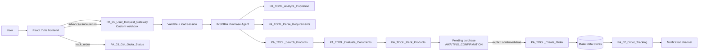

# INSPIRA Make.com implementation

This document is the account-neutral build sheet for the INSPIRA hackathon app. Make.com is the orchestration brain. The React app is a presentation/client layer and never owns hard-constraint decisions, order validation, or provider credentials.

The repository includes [`../make/inspira-scenario-spec.json`](../make/inspira-scenario-spec.json) as a reusable scenario spec. A live Make import still needs account-specific webhook URLs, Data Store IDs, provider connections, and module-version choices, so those values are intentionally placeholders.

## 1. Final architecture



### Scenario names

1. `PA_01_User_Request_Gateway`
2. `PA_02_Order_Tracking`
3. `PA_03_Get_Order_Status`
4. `PA_TOOL_Analyze_Inspiration`
5. `PA_TOOL_Parse_Requirements`
6. `PA_TOOL_Search_Products`
7. `PA_TOOL_Evaluate_Constraints`
8. `PA_TOOL_Rank_Products`
9. `PA_TOOL_Create_Order`
10. `PA_TOOL_Cancel_Order`
11. `PA_TOOL_Request_Return`

## 2. Data Stores

Create the following Make Data Stores. Use string fields for IDs and enums. Use number fields for money/days/quantity. Store JSON arrays/objects as text in fields ending in `_json` so the records remain portable.

### `user_sessions`

| Field | Type | Notes |
|---|---|---|
| `session_id` | Text, key | Generated if missing: `sess_<random>_<timestamp>` |
| `conversation_id` | Text | Browser-generated stable conversation ID |
| `created_at` | Date | ISO 8601 |
| `updated_at` | Date | ISO 8601 |
| `last_user_message` | Text | Truncate to a safe log limit if needed |
| `current_state` | Text | `NEW`, `CLARIFYING`, `SEARCHING`, `RECOMMENDED`, `AWAITING_CONFIRMATION`, `ORDER_CREATED`, `TRACKING`, `COMPLETED`, `CANCELLED` |

### `purchase_requirements`

| Field | Type | Notes |
|---|---|---|
| `requirement_id` | Text, key | `req_<random>` |
| `session_id` | Text | Foreign key to `user_sessions` |
| `raw_request` | Text | User-provided text only |
| `product_category` | Text | Normalized category |
| `purchase_mode` | Text | `single_product`, `multi_product`, `outfit_bundle`, `inspiration_match` |
| `quantity` | Number | Default only when the user did not specify and one unit is meaningful |
| `currency` | Text | `INR` for demo |
| `max_budget` | Number | Null if not supplied; never invent |
| `preferred_brands` | Text | JSON array |
| `required_specs` | Text | JSON object; hard constraints |
| `preferred_specs` | Text | JSON object; soft preferences |
| `delivery_location` | Text | City/region |
| `delivery_postal_code` | Text | Optional |
| `required_delivery_date` | Date | Null if absent |
| `max_delivery_days` | Number | Null if absent |
| `occasion` | Text | Optional |
| `style_keywords` | Text | JSON array |
| `color_preferences` | Text | JSON array |
| `size` | Text | Optional |
| `must_have_requirements` | Text | JSON array |
| `nice_to_have_requirements` | Text | JSON array |
| `excluded_attributes` | Text | JSON array |
| `clarification_needed` | Boolean | |
| `clarification_question` | Text | Null when not needed |
| `created_at` | Date | |
| `updated_at` | Date | |

### `pending_purchases`

| Field | Type | Notes |
|---|---|---|
| `approval_token` | Text, key | High-entropy random token |
| `session_id` | Text | |
| `recommendation_id` | Text | |
| `product_ids` | Text | JSON array |
| `items_json` | Text | Snapshot of selected normalized items |
| `total_product_cost` | Number | Subtotal before shipping/discount |
| `shipping_cost` | Number | Demo/seller adapter output |
| `discount` | Number | Number, default `0` |
| `final_total` | Number | `subtotal + shipping - discount` |
| `currency` | Text | `INR` |
| `delivery_estimate` | Text | Date or user-readable estimate |
| `status` | Text | `PENDING_CONFIRMATION`, `APPROVED`, `REJECTED`, `EXPIRED`, `PURCHASED` |
| `expires_at` | Date | Default `created_at + 20 minutes` |
| `created_at` | Date | |

### `orders`

| Field | Type | Notes |
|---|---|---|
| `order_id` | Text, key | `INSP-YYYYMMDD-XXXXXX` |
| `session_id` | Text | |
| `approval_token` | Text | Used for idempotency audit |
| `items_json` | Text | Final item snapshot |
| `seller_json` | Text | Demo seller snapshot |
| `subtotal` | Number | |
| `shipping_cost` | Number | |
| `discount` | Number | |
| `total_amount` | Number | |
| `currency` | Text | `INR` |
| `shipping_address` | Text | Demo city/address only; no real payment info |
| `order_status` | Text | `CONFIRMED`, `PROCESSING`, `PACKED`, `SHIPPED`, `OUT_FOR_DELIVERY`, `DELIVERED`, `CANCEL_REQUESTED`, `CANCELLED`, `RETURN_REQUESTED`, `RETURNED`, `REFUND_PROCESSING`, `REFUNDED` |
| `payment_status` | Text | `MOCK_PAID`, `NOT_APPLICABLE`, `REFUNDED` |
| `tracking_status` | Text | Same operational status family |
| `estimated_delivery` | Text | |
| `created_at` | Date | |
| `updated_at` | Date | |
| `last_notified_status` | Text | Prevent duplicate notifications |
| `data_source` | Text | `DEMO`, `MOCK_COMMERCE_ADAPTER`, or provider name |

### `order_events`

| Field | Type | Notes |
|---|---|---|
| `event_id` | Text, key | `evt_<random>` |
| `order_id` | Text | |
| `previous_status` | Text | |
| `new_status` | Text | |
| `event_timestamp` | Date | |
| `message` | Text | User-safe message |
| `notification_sent` | Boolean | |

### `user_preferences`

| Field | Type | Notes |
|---|---|---|
| `session_id` | Text, key | Use a user ID here when auth is added |
| `preferred_brands` | Text | JSON array |
| `preferred_categories` | Text | JSON array |
| `preferred_styles` | Text | JSON array |
| `price_sensitivity` | Text | `low`, `medium`, `high` |
| `delivery_priority` | Text | `low`, `medium`, `high` |
| `seller_quality_priority` | Text | `low`, `medium`, `high` |
| `saved_sizes` | Text | JSON object |
| `updated_at` | Date | |

## 3. Webhook contracts

### `PA_01_User_Request_Gateway` request

```json
{
  "session_id": "optional-existing-id",
  "conversation_id": "browser-generated-id",
  "action": "shop",
  "input_type": "text|image|voice|combined",
  "message": "I want an outfit like this for a Goa trip",
  "image_url": null,
  "image_data": null,
  "context": {
    "currency": "INR",
    "location": "Bangalore",
    "postal_code": null
  }
}
```

Accepted actions: `shop`, `confirm_purchase`, `track_order`, `advance_order`, `cancel_order`, `request_return`.

### Response envelope — every route

```json
{
  "success": true,
  "session_id": "sess_abc123",
  "state": "RECOMMENDED",
  "response_type": "clarification|recommendations|approval_required|order_confirmation|tracking|error",
  "message": "Human-readable, user-safe message",
  "data": {}
}
```

### Shop response: recommendations

```json
{
  "success": true,
  "session_id": "sess_abc123",
  "state": "AWAITING_CONFIRMATION",
  "response_type": "recommendations",
  "message": "I found 3 valid ways to wear the idea.",
  "data": {
    "recommendation_id": "rec_20260920_001",
    "requirements_summary": {
      "budget": "₹6,000",
      "delivery": "within 5 days",
      "must_haves": ["coordinated look", "breathable feel"]
    },
    "recommendations": [
      {
        "rank": 1,
        "product_id": "bundle-sandstone",
        "title": "The Sandstone Set",
        "total_cost": 5219,
        "delivery_days": 3,
        "score": 94,
        "hard_constraints_pass": true,
        "why_it_matches": [
          "The oatmeal shirt and pleated trouser echo the image’s relaxed silhouette.",
          "All three pieces arrive within your 5-day Bangalore window."
        ],
        "verified_fields": ["stock", "rating", "seller_reliability"],
        "simulated_fields": ["price", "shipping", "delivery_estimate"],
        "ai_inferred_fields": ["style_similarity", "palette_match"]
      }
    ]
  }
}
```

### Confirm request

```json
{
  "session_id": "sess_abc123",
  "conversation_id": "browser-generated-id",
  "action": "confirm_purchase",
  "confirmed": true,
  "approval_token": "appr_high_entropy_token"
}
```

Never infer `confirmed=true` from “nice”, “looks good”, or a recommendation selection. The frontend’s confirmation button is the only source of this explicit boolean.

### Track request

```json
{
  "session_id": "sess_abc123",
  "action": "track_order",
  "order_id": "INSP-20260920-A82K19"
}
```

### Demo advance request

```json
{
  "session_id": "sess_abc123",
  "action": "advance_order",
  "order_id": "INSP-20260920-A82K19"
}
```

## 4. `PA_01_User_Request_Gateway`

### Module-by-module configuration

#### Module 1

**App:** Webhooks  
**Module:** Custom webhook  
**Purpose:** Receive the stable frontend contract.  
**Configuration:** Name the hook `INSPIRA_GATEWAY_WEBHOOK`; capture the request sample above.  
**Input mapping:** Whole request body.  
**Output:** Parsed request bundle.

#### Module 2

**App:** Tools  
**Module:** Set multiple variables  
**Purpose:** Normalize request fields and timestamp.  
**Configuration:**

```json
{
  "request_id": "req_{{formatDate(now; 'YYYYMMDDHHmmss')}}_{{random}}",
  "session_id": "{{ifempty(1.session_id; concat('sess_'; random; '_'; formatDate(now; 'HHmmss')))}}",
  "action": "{{1.action}}",
  "message": "{{trim(1.message)}}",
  "has_image": "{{not(empty(1.image_url)) or not(empty(1.image_data))}}",
  "currency": "{{ifempty(1.context.currency; 'INR')}}",
  "location": "{{ifempty(1.context.location; 'Bangalore')}}"
}
```

#### Module 3

**App:** Flow Control  
**Module:** Router — Validate request  
**Purpose:** Reject malformed requests before an AI call.  
**Route A filter:** `action = shop` AND (`length(message) > 0 OR has_image = true`).  
**Route B filter:** `action = confirm_purchase` AND `approval_token exists`.  
**Route C filter:** `action = track_order` AND `order_id exists`.  
**Route D filter:** `action = advance_order` AND `order_id exists`.  
**Route E filter:** `action = cancel_order` AND `order_id exists`.  
**Route F filter:** `action = request_return` AND `order_id exists`.  
**Invalid route output:** envelope with `success=false`, `response_type=error`, `state=NEW`, `message=Invalid payload`.

#### Module 4

**App:** Data store  
**Module:** Get a record  
**Purpose:** Load `user_sessions` by `session_id`.  
**Input mapping:** `session_id = Module 2.session_id`.  
**Output:** Existing session or empty.

#### Module 5

**App:** Data store  
**Module:** Add/replace a record  
**Purpose:** Create a session if Module 4 returned no record.  
**Filter:** `Module 4.record_found = false`.  
**Mapping:** `session_id`, `conversation_id`, `created_at=now`, `updated_at=now`, `last_user_message=message`, `current_state=NEW`.

#### Module 6

**App:** Flow Control  
**Module:** Router — Action routes  
**Purpose:** Keep each operation explicit and auditable.  
**Filters:**

```text
shop               => action = "shop"
confirm_purchase   => action = "confirm_purchase"
track_order        => action = "track_order"
advance_order      => action = "advance_order"
cancel_order       => action = "cancel_order"
request_return     => action = "request_return"
```

#### Module 7 — shop route

**App:** Data store  
**Module:** Add/replace `user_sessions`  
**Mapping:** Set `current_state=SEARCHING`; preserve `created_at`; update `updated_at`, `last_user_message`.

#### Module 8 — shop route

**App:** Make AI Agents  
**Module:** Run an agent  
**Purpose:** Orchestrate inspiration analysis, requirement parsing, search, deterministic filtering, scoring, recommendation, and approval-record creation.  
**Agent:** `INSPIRA Purchase Agent`.  
**Input:** `message`, `image_url`, `image_data`, existing session requirements, user preferences, `currency`, `location`.  
**Attached tools:** Modules/scenarios named `PA_TOOL_*` below.  
**Output:** Strict internal result with `response_type`, `state`, `message`, `data`.

#### Module 9 — shop route

**App:** Data store  
**Module:** Add/replace `purchase_requirements`  
**Purpose:** Persist parsed requirements.  
**Filter:** `agent.data.requirements != empty`.

#### Module 10 — shop route

**App:** Data store  
**Module:** Add/replace `user_sessions`  
**Purpose:** Persist the resulting state: `CLARIFYING`, `RECOMMENDED`, or `AWAITING_CONFIRMATION`.

#### Module 11 — confirm route

**App:** Make AI Agents or Flow Control  
**Module:** Run `PA_TOOL_Create_Order`  
**Purpose:** Enforce the approval gate.  
**Input:** `confirmed`, `approval_token`, `session_id`; do not accept untrusted price or item totals from the frontend.

#### Module 12 — track route

**App:** Make scenario  
**Module:** Call `PA_03_Get_Order_Status`  
**Input:** `session_id`, `order_id`.

#### Module 13 — advance/cancel/return routes

**App:** Make scenario  
**Module:** Call the relevant tool scenario.  
**Purpose:** Demo tracking and post-order operations use the same order record and event log.

#### Module 14

**App:** Webhooks  
**Module:** Webhook response  
**Purpose:** Return the stable envelope.  
**Configuration:** Always return JSON with `Content-Type: application/json`; include `success`, `session_id`, `state`, `response_type`, `message`, and `data`, even on errors.

## 5. `PA_TOOL_Analyze_Inspiration`

### Input

```json
{
  "image": "{{image_url_or_data}}",
  "user_text": "{{message}}"
}
```

### Modules

1. **Webhooks > Custom webhook** or scenario input: capture `image` and `user_text`.
2. **Flow Control > Filter:** require an image; if absent, return `detected_products=[]` and `suggested_question=null`.
3. **HTTP > Make a request** or native multimodal AI module: use `{{AI_PROVIDER_CONNECTION}}`; send the image and the structured prompt below.
4. **JSON > Parse JSON:** validate the strict schema. Route parse failure to error handler.
5. **Webhooks > Webhook response:** return only the JSON object below.

### Structured prompt

```text
You analyze a shopping inspiration image. Extract searchable visual attributes, not product facts.

User text: {{user_text}}

Rules:
- Never claim a visible brand, exact material, price, model, stock, or product identity as verified.
- Use phrases such as linen-like texture or appears to be when uncertain.
- If the image contains multiple items, list them separately.
- Output only valid JSON. No markdown. No additional keys.

Schema:
{
  "detected_products": [
    {
      "category": "",
      "subcategory": "",
      "style": [],
      "colors": [],
      "materials_visual_guess": [],
      "patterns": [],
      "fit": "",
      "occasion": "",
      "brand_visible": null,
      "search_keywords": []
    }
  ],
  "scene_context": "",
  "confidence": 0.0,
  "uncertain_attributes": [],
  "suggested_question": null
}
```

### Output example

```json
{
  "detected_products": [{
    "category": "shirt",
    "subcategory": "oversized relaxed shirt",
    "style": ["minimal", "resort", "relaxed"],
    "colors": ["oat", "beige"],
    "materials_visual_guess": ["linen-like texture"],
    "patterns": [],
    "fit": "relaxed",
    "occasion": "warm-weather travel",
    "brand_visible": null,
    "search_keywords": ["oat relaxed shirt", "linen-look shirt"]
  }],
  "scene_context": "travel outfit on a warm neutral surface",
  "confidence": 0.89,
  "uncertain_attributes": ["actual fiber content", "brand"],
  "suggested_question": "Are you looking for the whole outfit or one piece from it?"
}
```

## 6. `PA_TOOL_Parse_Requirements`

### Input

```json
{
  "raw_request": "{{message}}",
  "inspiration_analysis": "{{jsonstringify(inspiration_analysis)}}",
  "existing_session_requirements": "{{jsonstringify(existing_requirements)}}"
}
```

### Structured prompt

```text
Convert the user's request and optional visual analysis into purchase requirements.

Hard constraint language includes: must, need, required, under, maximum, within, before, at least, only.
Soft preference language includes: prefer, ideally, would like, nice, if possible.

Rules:
- Never invent a budget or deadline.
- Never infer a required spec merely because it is visually plausible.
- Ask one concise clarification question only when a missing field blocks meaningful selection.
- Ask at most 1–2 questions at once.
- Output only JSON using exactly this schema.

{
  "product_category": "",
  "purchase_mode": "single_product",
  "quantity": 1,
  "currency": "INR",
  "max_budget": null,
  "preferred_brands": [],
  "required_specs": {},
  "preferred_specs": {},
  "delivery_location": null,
  "required_delivery_date": null,
  "max_delivery_days": null,
  "occasion": null,
  "style_keywords": [],
  "must_have_requirements": [],
  "nice_to_have_requirements": [],
  "excluded_attributes": [],
  "missing_critical_fields": [],
  "clarification_needed": false,
  "clarification_question": null
}
```

## 7. `PA_TOOL_Search_Products`

### Modules

1. **HTTP > Make a request**  
   `GET https://dummyjson.com/products/search?q={{urlencode(query)}}`
2. **HTTP > Make a request** for category fallback when result count is `0`:  
   `GET https://dummyjson.com/products/category/{{urlencode(category)}}`
3. **Flow Control > Iterator:** iterate over `products[]`.
4. **Tools > Set multiple variables:** normalize source fields.
5. **Tools > Set multiple variables:** apply deterministic mock commerce adapter values.
6. **Flow Control > Array aggregator:** aggregate normalized candidates.
7. **Webhook response / scenario return:** return the normalized array.

### Normalized product object

```json
{
  "product_id": "",
  "title": "",
  "category": "",
  "description": "",
  "price": 0,
  "currency": "INR",
  "rating": 0,
  "stock": 0,
  "brand": "",
  "specifications": {},
  "seller": "",
  "seller_reliability": null,
  "shipping_cost": null,
  "delivery_days": null,
  "delivery_date": null,
  "thumbnail": "",
  "product_url": "",
  "source": "dummyjson",
  "source_fields": {},
  "simulated_fields": {}
}
```

### Provenance rules

- DummyJSON response fields go into `source_fields` and are labeled `VERIFIED_API`.
- Adapter fields go into `simulated_fields` and are labeled `SIMULATED`.
- Visual interpretations are attached later from `AI_INFERRED`, never copied into verified fields.
- Derive stable demo values from `product_id`, e.g. `shipping_cost = 99 + (id % 3) * 50`, and do not call `random()` for pricing.

## 7a. Remaining tool module maps

Use these exact module sequences when creating the remaining callable tool scenarios. Each tool should return JSON to the parent agent and should not send user-facing prose on its own.

### `PA_TOOL_Parse_Requirements`

1. **Tools > Set multiple variables:** map `raw_request`, `inspiration_analysis`, `existing_session_requirements`.
2. **Make AI Agents / HTTP > Make a request:** structured prompt in section 6; bind `{{AI_PROVIDER_CONNECTION}}`.
3. **JSON > Parse JSON:** strict schema; error handler on malformed output.
4. **Flow Control > Filter:** if `clarification_needed=true`, stop before product search and return the question.
5. **Scenario output:** return the exact requirement object.

### `PA_TOOL_Rank_Products`

1. **Array aggregator:** receive only `eligible=true` candidates from constraint evaluation.
2. **Flow Control > Iterator:** one candidate per bundle.
3. **Tools > Set multiple variables or Code:** compute the six score components in section 9.
4. **Array aggregator:** rebuild scored candidates with `score_breakdown` and provenance.
5. **Tools > Sort an array:** `score DESC`, `total_cost ASC`, `delivery_days ASC`.
6. **Tools > Set variable:** take the first three records.
7. **Scenario output:** recommendations array; empty array is valid and routes to no-match handling.

### `PA_TOOL_Create_Order`

1. **Data store > Get a record:** lookup `pending_purchases` by `approval_token`.
2. **Flow Control > Filter:** `confirmed=true`, matching `session_id`, non-expired, `status=PENDING_CONFIRMATION`.
3. **Data store > Search records:** find an existing order by `approval_token`.
4. **Flow Control > Filter:** idempotency passes only when zero existing orders are found.
5. **HTTP > Make a request / mock adapter:** verify current stock and price snapshot.
6. **Flow Control > Router:** success, price changed, out of stock, expired, duplicate.
7. **Data store > Add a record:** write `orders` only on success.
8. **Data store > Update a record:** set pending status to `PURCHASED`.
9. **Data store > Add a record:** write `order_events` with `CONFIRMED`.
10. **Scenario output:** stable success/error JSON.

### `PA_TOOL_Cancel_Order`

1. **Data store > Get a record:** lookup `orders` by `order_id`.
2. **Flow Control > Filter:** reject delivered/cancelled/returned/refunded states.
3. **Data store > Update a record:** set `order_status=CANCELLED`, `tracking_status=CANCELLED`.
4. **Data store > Add a record:** write `order_events` with previous/new status.
5. **Scenario output:** cancellation result and current order status.

### `PA_TOOL_Request_Return`

1. **Data store > Get a record:** lookup `orders` by `order_id`.
2. **Flow Control > Filter:** require `order_status=DELIVERED` and policy window active.
3. **Data store > Update a record:** set `order_status=RETURN_REQUESTED`.
4. **Data store > Add a record:** write return event.
5. **Scenario output:** return request ID and `REFUND_PROCESSING` status if the demo policy applies.

## 8. `PA_TOOL_Evaluate_Constraints`

Use deterministic Make functions or a Code module. Do not ask the LLM to decide whether a hard constraint passes.

### Code module input

```json
{
  "candidate": "{{jsonstringify(candidate)}}",
  "requirements": "{{jsonstringify(requirements)}}"
}
```

### Deterministic formulas

```text
product_subtotal = candidate.unit_price * requirements.quantity
total_cost = product_subtotal + candidate.shipping_cost - valid_discount
budget_pass = requirements.max_budget is null OR total_cost <= requirements.max_budget
stock_pass = candidate.stock >= requirements.quantity
delivery_pass = requirements.max_delivery_days is null OR candidate.delivery_days <= requirements.max_delivery_days
spec_pass = every definitely-known required spec matches candidate.specifications/tags
eligible = budget_pass AND stock_pass AND delivery_pass AND spec_pass
```

### Output

```json
{
  "eligible": true,
  "failed_constraints": [],
  "product_subtotal": 0,
  "total_cost": 0,
  "constraint_results": {
    "budget": "PASS",
    "stock": "PASS",
    "delivery": "PASS",
    "required_specs": "PASS"
  },
  "provenance": {
    "verified": [],
    "simulated": [],
    "ai_inferred": []
  }
}
```

### Filters

- Recommendation route: `eligible = true`.
- Rejected-options route: `eligible = false` AND `failed_constraints is not empty`.
- Never send rejected candidates into `PA_TOOL_Rank_Products`.

For bundles, run the same calculation over each item, then calculate `bundle_total = sum(item_totals) + bundle_shipping - bundle_discount` and `latest_delivery_days = max(item.delivery_days)`.

## 9. `PA_TOOL_Rank_Products`

### Scoring formula

```text
score = specification_fit (35)
      + delivery_performance (20)
      + seller_quality (15)
      + budget_value (15)
      + user_preferences (10)
      + return_policy (5)
```

Run only on `eligible=true`. Return at most three results. Sort descending by score, then ascending by total cost, then ascending by delivery days.

```json
{
  "score": 87,
  "score_breakdown": {
    "specification_fit": 32,
    "delivery": 18,
    "seller_quality": 12,
    "budget_value": 14,
    "preferences": 8,
    "return_policy": 3
  },
  "reasoning_summary": "Meets the required spec, clears the delivery window, and keeps the total below budget.",
  "hard_constraint_pass": true
}
```

## 10. `PA_TOOL_Create_Order`

### Pre-flight verification filters

All conditions must pass:

```text
confirmed = true
approval_token exists
pending_purchases.approval_token = input.approval_token
pending_purchases.status = PENDING_CONFIRMATION
now < pending_purchases.expires_at
pending_purchases.session_id = input.session_id
stored pricing = current pricing snapshot
stock >= stored quantity
approval token has not previously produced an order
```

If any check fails, return `success=false` and do not write to `orders`.

### Modules

1. **Data store > Get a record:** `pending_purchases` by `approval_token`.
2. **Flow Control > Filter:** all pre-flight conditions above.
3. **Data store > Search records:** search `orders` by `approval_token` for idempotency.
4. **HTTP / mock commerce adapter:** recheck product stock and snapshot price.
5. **Flow Control > Router:** success vs price-changed/out-of-stock/expired.
6. **Data store > Add a record:** `orders`; generate `INSP-YYYYMMDD-XXXXXX`.
7. **Data store > Update a record:** pending purchase status `PURCHASED`.
8. **Data store > Add a record:** `order_events`, `CONFIRMED` event.
9. **Webhook response:** order confirmation envelope.

### Success response

```json
{
  "success": true,
  "order_id": "INSP-20260920-A82K19",
  "order_status": "CONFIRMED",
  "payment_status": "MOCK_PAID",
  "total": 5219,
  "currency": "INR",
  "estimated_delivery": "2026-09-23",
  "message": "Your simulated hackathon order has been created successfully."
}
```

Never claim a real purchase. Use `simulated order`, `mock purchase`, and `demo transaction` in user-facing copy.

## 11. `PA_02_Order_Tracking`

### Modules

1. **Scheduler:** every 15 minutes for the demo; every 1 hour for a slower demo. Enable “on demand” for judge walkthroughs.
2. **Data store > Search records:** `orders` where `order_status` is active and not `CANCELLED`, `DELIVERED`, or `REFUNDED`.
3. **HTTP > Make a request** (optional): call a mock order API. If no API exists, use a deterministic status sequence by age or the manual advance endpoint.
4. **Flow Control > Iterator:** iterate active orders.
5. **Flow Control > Filter:** `old_status != current_status`.
6. **Data store > Add a record:** `order_events`.
7. **Data store > Update a record:** `orders.order_status`, `tracking_status`, `updated_at`, `last_notified_status`.
8. **Notifications module or HTTP request:** send only when status changed.

### Manual demo advance endpoint

Reuse `PA_01_User_Request_Gateway` with `action=advance_order`, or create a second webhook route under `PA_02`. Advance in this order:

```text
CONFIRMED -> PROCESSING -> PACKED -> SHIPPED -> OUT_FOR_DELIVERY -> DELIVERED
```

## 12. `PA_03_Get_Order_Status`

### Modules

1. **Webhooks > Custom webhook:** accept `session_id` and `order_id`.
2. **Tools > Validate:** require both values.
3. **Data store > Get a record:** `orders` by `order_id`.
4. **Data store > Search records:** `order_events` by `order_id`, sorted newest first.
5. **Webhook response:** return status, tracking status, ETA, and timeline.

### Response

```json
{
  "order_id": "INSP-20260920-A82K19",
  "status": "SHIPPED",
  "tracking_status": "IN_TRANSIT",
  "estimated_delivery": "2026-09-23",
  "timeline": [
    { "status": "CONFIRMED", "timestamp": "2026-09-20T09:42:00+05:30", "message": "Demo order created" },
    { "status": "SHIPPED", "timestamp": "2026-09-20T09:46:00+05:30", "message": "On the way to Bangalore" }
  ]
}
```

## 13. Cancel and return tools

### `PA_TOOL_Cancel_Order`

1. Get `orders` by `order_id`.
2. Filter: status is not `DELIVERED`, `CANCELLED`, `RETURNED`, or `REFUNDED`.
3. Update `order_status=CANCEL_REQUESTED` then `CANCELLED` for the demo adapter.
4. Add `order_events` record.
5. Return confirmation.

### `PA_TOOL_Request_Return`

1. Get `orders` by `order_id`.
2. Filter: `order_status=DELIVERED` AND demo policy window has not expired AND order is not already returned.
3. Update `order_status=RETURN_REQUESTED`.
4. Add `order_events` record.
5. Return next step and simulated refund status.

The frontend should show a confirmation step before either consequential action in a production implementation.

## 14. Main AI Agent system prompt

```text
You are INSPIRA, an autonomous but approval-gated AI purchasing assistant.

Translate user intent or visual inspiration into structured requirements, use your tools to search products, enforce hard constraints, compare valid options, recommend a small set of strong matches, request explicit confirmation, place a simulated order only after confirmation, and assist with tracking, cancellation, and returns.

You are not merely a recommendation chatbot.

Use tools whenever factual product or order information is required. Never invent API results. Never claim simulated information is verified. Never claim AI-inferred visual information is verified.

Clearly distinguish USER PROVIDED, VERIFIED API, AI INFERRED, SIMULATED, and AI RECOMMENDATION.

Treat mandatory requirements as hard constraints. A product failing any mandatory constraint cannot be presented as a valid recommendation. Use deterministic totals: unit price × quantity + shipping − discount. Consider fit, budget, delivery, availability, quantity, seller quality, rating, shipping, and preferences. Never choose based only on lowest price.

Ask clarification only when necessary, and ask no more than 1–2 concise questions at once. If enough information exists, take action instead of asking another question.

When an image is provided, infer searchable visual attributes but acknowledge uncertain characteristics. Use product tools before making product claims.

Never place an order without explicit user confirmation. “Nice”, “looks good”, “interesting”, or selecting a recommendation are not confirmation. Purchase confirmation must be explicit and passed as confirmed=true with the existing approval token. Never create a second order from the same approval token. Never state that a purchase succeeded unless the order tool returns success.

Use concise, useful language. For recommendations explain why an item qualifies, the total cost, delivery expectation, the requirements satisfied, and which information is simulated or uncertain.
```

## 15. Error handling matrix

| Failure | Deterministic action | User-safe response |
|---|---|---|
| Invalid payload | Stop before AI; return 400-style envelope | “Please add a request or an inspiration image.” |
| AI JSON parse error | Error handler; log request ID only; no recommendation | “I couldn’t structure that brief yet. Please try again.” |
| API timeout | Retry once with backoff; then return error | “The product source timed out. No order was created.” |
| No products | Keep `RECOMMENDED` false; do not create approval | “I couldn’t find a match without relaxing a requirement.” |
| No valid products | Preserve rejected reasons | “I found alternatives, but I won’t present them as valid matches.” |
| Expired approval | Do not create order; mark `EXPIRED` | “That held selection expired. I have not placed the order.” |
| Price changed | Do not create order; require fresh approval | “The stored price changed. I have not placed the order. Updated total: ₹X.” |
| Out of stock | Do not create order; recommend re-search | “The selected item went out of stock. I have not placed the order.” |
| Order creation failure | Do not mark `PURCHASED`; log event | “The order API did not confirm the transaction, so it is not marked completed.” |
| Tracking unavailable | Keep last known status | “Tracking is temporarily unavailable. Last known status: X.” |
| Duplicate confirmation | Return original order by approval token | “This approval already created order X; no second order was created.” |

## 16. Test payloads and expected results

### Test 1 — Office chair

```json
{
  "conversation_id": "test-chair-001",
  "action": "shop",
  "input_type": "text",
  "message": "I need an office chair under ₹12,000 with good back support, delivered to Bangalore within 5 days.",
  "context": { "currency": "INR", "location": "Bangalore" }
}
```

Expected: a chair with `budget=12000`, `max_delivery_days=5`, `good back support` as a hard requirement; valid options only; `response_type=recommendations`; no order before confirmation.

### Test 2 — hard delivery rejection

```json
{
  "conversation_id": "test-headphones-001",
  "action": "shop",
  "input_type": "text",
  "message": "I need headphones under ₹10,000 delivered within 3 days.",
  "context": { "currency": "INR", "location": "Bangalore" }
}
```

Expected: a candidate with `₹7,000` and `10 days` is `eligible=false`; failed constraint is exactly `delivery`; it cannot enter ranked recommendations.

### Test 3 — inspiration image

```json
{
  "conversation_id": "test-image-001",
  "action": "shop",
  "input_type": "combined",
  "message": "I want something like this for a Goa trip.",
  "image_url": "https://example.test/inspiration.png",
  "context": { "currency": "INR", "location": "Bangalore" }
}
```

Expected: visual analysis returns relaxed shirt / trousers / sneaker attributes; the agent asks one question such as “whole outfit or only the shirt?”; after “Whole outfit under ₹6,000 and deliver it to Bangalore within 5 days.” the bundle engine calculates combined total and returns no more than three valid bundles.

### Test 4 — no confirmation

Input after recommendations: `Nice.`  
Expected: no `confirm_purchase` route; no `orders` record.

### Test 5 — explicit confirmation

```json
{
  "action": "confirm_purchase",
  "session_id": "sess_test_image_001",
  "approval_token": "appr_test_001",
  "confirmed": true
}
```

Expected: pending purchase is revalidated; order ID follows `INSP-YYYYMMDD-XXXXXX`; `payment_status=MOCK_PAID`; pending status becomes `PURCHASED`.

### Test 6 — tracking

```json
{
  "action": "advance_order",
  "session_id": "sess_test_image_001",
  "order_id": "INSP-20260920-A82K19"
}
```

Expected: one new `order_events` record, `tracking_status` advances once, and notification sends only when the status differs from `last_notified_status`.

### Test 7 — order failure

Configure the mock adapter to return an error.  
Expected: `orders` is not written as `CONFIRMED`, the response says the order was not confirmed, and no success claim reaches the frontend.

## 17. 90-second demo script

1. Open INSPIRA and click **Use a demo inspiration**.
2. Say: “I want an outfit like this for a Goa trip.”
3. Point out the AI-inferred category, palette, and relaxed silhouette.
4. Choose **Whole outfit** if the clarification appears.
5. Show the three ranked sets: combined cost, delivery, stock, and provenance labels.
6. Select **The Sandstone Set**.
7. Pause at the approval receipt: “Nothing has been ordered yet.”
8. Click **Confirm simulated purchase**.
9. Read the `INSP-...` order ID and `MOCK_PAID` status.
10. Open tracking and click **Advance demo status** until `SHIPPED`.
11. Point to the synced notification and explain that status changes are events.

## 18. Three-minute judge presentation

**Problem (30s):** Search assumes you know the product name. Inspiration is visual, contextual, and often multi-product.

**Product (45s):** INSPIRA turns a screenshot and a sentence into a purchase brief, asks only the missing question, then searches and builds a valid option—not just a vague list.

**Trust model (45s):** The AI interprets meaning. Make tools provide product data. Deterministic filters enforce budget, stock, delivery, quantity, and specifications. Every field is labeled verified, simulated, or AI-inferred.

**Action loop (45s):** No recommendation is an order. A pending approval record holds the exact item snapshot and expires. The order tool verifies the token, price, stock, and explicit `confirmed=true` before it creates a simulated transaction.

**Close (15s):** “I showed INSPIRA what inspired me. It figured out what I wanted, found valid products, respected my constraints, asked for approval, bought them in the demo environment, and kept tracking the order.”

## 19. Final checklist

- [ ] Make AI Agent active
- [ ] Agent tools attached
- [ ] `PA_01_User_Request_Gateway` webhook working
- [ ] `PA_02_Order_Tracking` scheduler working
- [ ] `PA_03_Get_Order_Status` endpoint working
- [ ] Product API working
- [ ] Mock commerce adapter values deterministic
- [ ] All six Data Stores created
- [ ] Image understanding working
- [ ] Requirement parser returns strict JSON
- [ ] Hard constraint filtering working
- [ ] Bundle/outfit optimization working
- [ ] Ranking limited to eligible candidates
- [ ] Recommendation provenance labels working
- [ ] Approval gate creates a pending purchase
- [ ] Confirm path requires explicit approval token
- [ ] Mock purchase creates idempotent order ID
- [ ] Tracking event and notification working
- [ ] Cancel and return policy filters working
- [ ] Frontend connected to Make webhook or local fallback
- [ ] No payment information stored
- [ ] Test 1–7 executed
- [ ] 90-second demo rehearsed
